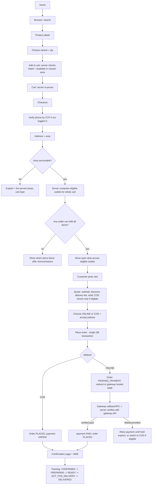
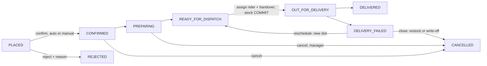
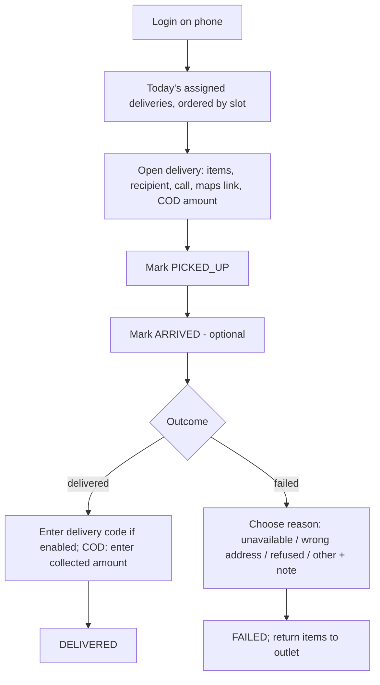

> **Superseded in part (Phase 2).** This document describes the original delivery-slot / area / COD / rider design, which the Phase 2 backend replaced. Current documents: [PHASE2_BACKEND](PHASE2_BACKEND.md), [ADMIN_AND_API_CONTRACT](ADMIN_AND_API_CONTRACT.md), [DEPLOY_PHASE2](DEPLOY_PHASE2.md). Where they disagree, Phase 2 wins.

# Application Flows

Status: Draft v0.1 — 2026-10-19. Status names match DATABASE_SCHEMA.md §8.

## 1. Customer journey

### 1.1 Happy path

### 1.2 Area-first browsing
On first visit the customer may set their delivery area (banner). With an area set, listing pages show "available" only if at least one outlet serving the area lists the variant with stock; without an area, availability is shown as "check at checkout". The area is stored in the cart, not in a tracking cookie.

### 1.3 Exception flows

| Situation | Behaviour |
|-----------|-----------|
| Item goes out of stock between cart and placement | Placement fails atomically; response lists affected lines with current availability; customer adjusts. Nothing reserved. |
| Slot fills during checkout | Placement fails with `SLOT_FULL`; slot list refreshes; other choices kept. |
| Price changed since cart viewed | Quote is recalculated at placement; if total differs from the quote the customer accepted (quote hash mismatch), return `PRICE_CHANGED` with new totals; customer must re-confirm. |
| Coupon became invalid | `COUPON_INVALID` with reason; customer may continue without it. |
| Double-tap "Place order" | Same `Idempotency-Key` → same order returned. |
| Browser closed during online payment | Order stays `PENDING_PAYMENT`; IPN/webhook or reconciliation job finalises. Customer sees status on return via order page (OTP login if needed). |
| Payment success URL reached but gateway verification says not paid | Show "pending verification"; never mark paid. Reconciliation job re-checks. |
| Payment verified after hold expired | If stock/slot still reservable → re-reserve and mark PLACED; otherwise mark payment PAID, order `CANCELLED` with reason `PAID_AFTER_EXPIRY`, auto-create refund task for Super Admin and notify customer. |
| Payment failed | Order stays `PENDING_PAYMENT` until expiry; customer may retry (new payment row, new `merchant_tran_id`) or switch to COD if eligible. |
| Customer cancels | Allowed while status ≤ `CONFIRMED` (D9). Releases stock + slot; if paid online, refund request created. |
| Outlet rejects | Order `REJECTED` with reason; stock/slot released; refund if paid; customer notified. No automatic re-routing to another outlet in v1 (would be a silent change); customer may reorder. |
| Delayed fulfilment (slot passed, not dispatched) | Order flagged "late" on outlet board after slot end + 15 min (configurable); manager must reschedule (customer notified) or cancel. |
| Unserviceable address entered on saved address | Address saved but marked "not currently served"; cannot be used at checkout. |

### 1.4 Account
OTP login → profile, addresses (add/edit/default/delete), order history, order detail + tracking, reorder (adds still-available variants to cart at **current** prices and explains changes), privacy: request data export, request deletion (processed by Super Admin; orders anonymised per F6).

### 1.5 Guest checkout
Customer verifies phone by OTP during checkout. The system creates/uses a customer account keyed by that phone (no password). Tracking requires the same OTP, so order privacy equals account privacy.

## 2. Outlet operations

### 2.1 Outlet order flow

Steps for staff:
1. Secure login (manager: password + TOTP).
2. Outlet dashboard: counts by status for today, late orders, low stock, today's slots with fill %.
3. Incoming orders list (PLACED). Confirm (validates stock still reserved) or reject with reason.
4. Preparation: pick list per order or per slot (aggregated quantities); mark READY.
5. Assign rider (manager or permitted staff) → delivery `ASSIGNED`. At physical handover, mark dispatched → order `OUT_FOR_DELIVERY`, stock committed.
6. Monitor delivery progress; handle failures; confirm COD cash handover at end of shift.

### 2.2 Inventory flows
- **Receive** stock: choose variant, qty, note (supplier/batch) → `RECEIVE`.
- **Adjust**: up/down with mandatory reason → movement + audit.
- **Write-off** (damaged/expired): manager only.
- **Count/reconcile**: start count (snapshot system qty) → enter counted qty → review differences → complete posts `RECONCILE` movements.
- **Transfer** (if enabled): manager requests → Super Admin approves → source dispatches (`TRANSFER_OUT`) → destination receives (`TRANSFER_IN`, received qty may differ; difference recorded).
- Low-stock alert when `available ≤ threshold` → dashboard badge + optional notification.

### 2.3 Outlet selection algorithm (fulfilment module)

Input: cart lines `(variant, qty)`, area, requested slot window (optional at quote time), now.

1. `candidates` = outlets where `status = ACTIVE` and `accepts_online_orders` and an active `outlet_zone_rule` exists for a zone containing the area.
2. Remove outlets where any line has `is_listed = false` or `on_hand − reserved < qty`.
3. Remove outlets where order subtotal < `min_order_poisha` for that zone rule (keep reason for messaging).
4. For each remaining outlet, collect open slots: `status OPEN`, `cutoff_at > now`, `booked_count < capacity`, within outlet hours, not on a closure date, within the booking horizon (setting, default 3 days).
5. Remove outlets with no slots.
6. Slot list to customer = union of slot windows (deduplicated by start/end time) across remaining outlets. Outlet identity is not shown.
7. On placement with chosen window: order remaining outlets by `(priority ASC, available_headroom DESC, code ASC)`; for each, inside the transaction try reserve stock + book slot; first success wins. If all fail → `SLOT_FULL` or `OUT_OF_STOCK` with refreshed options.
8. If step 2 empties the set but each line is available at *some* outlet, message: "এই সব পণ্য একসাথে একটি আউটলেট থেকে পাঠানো সম্ভব নয়" (cannot be sent together from one outlet) and mark the conflicting lines. Never split.

Delivery fee, minimum order and COD eligibility come from the **chosen** outlet's zone rule. Because several outlets can serve one window with different fees, the quote shows the fee of the outlet that would be chosen for that window (step 7 ordering without reservation); at placement, if the winning outlet differs and the total changes, `PRICE_CHANGED` is returned for re-confirmation.

## 3. Super Admin flow

Login (password + TOTP) → consolidated dashboard (orders, revenue by payment status, by outlet, late orders, payment exceptions, low stock across outlets) → manage outlets, staff, roles → catalogue and pricing → areas, zones, outlet rules, slot templates → coupons, banners, content → payments: reconciliation queue (pending > N min, duplicate captures, paid-after-expiry, amount mismatch), refunds → COD discrepancies → reports (date range, outlet filter, CSV) → audit log search.

## 4. Delivery staff flow

- Status updates are idempotent (client-generated update id) and queued offline, retried on reconnect.
- If COD collected amount ≠ expected → `DISCREPANCY` status, note mandatory, manager alerted.
- End of shift: rider hands cash to manager; manager confirms per delivery → `HANDED_OVER`; order payment `PAID`.

## 5. Delivery exception rules

| Case | Rule (defaults pending OPEN_DECISIONS D8, C6) |
|------|-------------------------------------------|
| Customer unavailable | Rider records attempt; outlet calls customer; manager may reschedule into a new slot (capacity enforced) — max 2 attempts, then close as failed. |
| Incorrect address | Attempt recorded; customer contacted to correct address within the same area; change to another area requires re-check of serviceability and fee (difference handled as a new quote; if increase, customer must accept). |
| Refused | Close as failed; items restock or write-off per staff choice; COD not collected; online payment → refund per policy. |
| Delayed fulfilment | See §1.3; customer notified of new slot. |
| Product stockout after confirmation (damage) | Manager may cancel item lines only with customer consent recorded (v1: cancel whole order and ask customer to reorder — partial edits are a later feature). |
| Rescheduling request by customer | Allowed until `READY_FOR_DISPATCH`; needs a free slot at the same outlet; staff approve. |

## 6. Payment flow detail (online)

1. `POST /checkout/orders` returns `{orderId, paymentId, next: "REDIRECT"}`.
2. `POST /payments/:paymentId/initiate` → server calls gateway with amount from DB, `merchant_tran_id`, success/fail/cancel URLs pointing to the **storefront return page** and IPN URL pointing to the **API**.
3. Customer pays on gateway page.
4. Gateway → API IPN/webhook (server-to-server) and browser → storefront return page.
5. API: store `payment_event` (dedupe), validate signature if provided, call gateway verification API, compare amount/currency/order ref/status, then in one transaction update payment + order + coupon + status event + notification.
6. Return page polls `GET /orders/:id/payment-status` (authenticated) until final state or timeout, then shows "we'll SMS you when confirmed".
7. Reconciliation job every 5 min: payments `PENDING` older than 10 min → verify; holds past `payment_expires_at` → verify once more, then expire.
