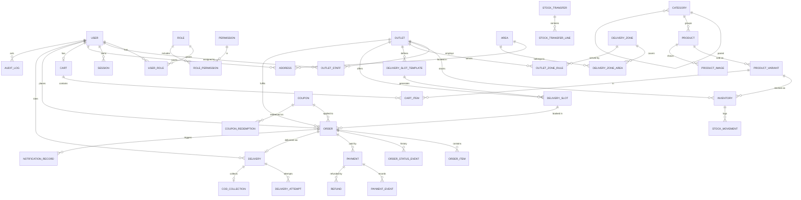

# Database Schema

Status: Draft v0.1 — 2026-10-19. The Prisma schema in `apps/api/prisma/schema.prisma` (Milestone 3) is generated from this document; any divergence is a bug in one of them.

Conventions:

- PostgreSQL ≥ 16. Table names `snake_case` plural-free singular (Prisma `@@map`).
- Primary keys: `uuid` (v7, time-ordered) generated by the API. Public order numbers are separate human-readable codes.
- Timestamps `timestamptz` in UTC; business dates (`slot_date`) are `date` interpreted in Asia/Dhaka.
- Money: `integer` poisha, suffix `_poisha`. Never `float`/`numeric` arithmetic in JS.
- Soft delete only where history must survive (`archived_at`); orders and payments are never deleted.
- Every outlet-owned table carries `outlet_id NOT NULL` and is indexed on it.

## 1. Entity-relationship diagram

## 2. Identity and access

### user
| Column | Type | Constraints |
|--------|------|-------------|
| id | uuid | PK |
| phone | varchar(14) | UNIQUE, nullable; E.164 `+8801XXXXXXXXX`, CHECK regex |
| email | citext | UNIQUE, nullable |
| full_name | varchar(120) | |
| password_hash | text | nullable (customers use OTP); argon2id |
| mfa_totp_secret_enc | bytea | nullable; AES-256-GCM encrypted with app key |
| mfa_enabled | boolean | default false |
| kind | enum `CUSTOMER`, `STAFF` | |
| status | enum `ACTIVE`, `SUSPENDED`, `DELETED` | |
| phone_verified_at | timestamptz | |
| last_login_at | timestamptz | |
| created_at / updated_at | timestamptz | |

CHECK: `phone IS NOT NULL OR email IS NOT NULL`. Staff must have `password_hash` (CHECK `kind <> 'STAFF' OR password_hash IS NOT NULL`).

### role / permission / role_permission / user_role
- `role(id, code UNIQUE, name, is_system boolean)` — system roles: `SUPER_ADMIN`, `OUTLET_MANAGER`, `OUTLET_STAFF`, `DELIVERY_STAFF`, `CUSTOMER`.
- `permission(id, code UNIQUE, description)` — e.g. `inventory.adjust`, `orders.confirm`. Full list in USER_ROLES_AND_PERMISSIONS.md.
- `role_permission(role_id, permission_id)` PK both.
- `user_role(user_id, role_id)` PK both. Global roles (`SUPER_ADMIN`, `CUSTOMER`) live here.

### outlet_staff (user ↔ outlet assignment)
| Column | Type | Constraints |
|--------|------|-------------|
| id | uuid | PK |
| user_id | uuid | FK user |
| outlet_id | uuid | FK outlet |
| role_id | uuid | FK role (`OUTLET_MANAGER` / `OUTLET_STAFF` / `DELIVERY_STAFF`) |
| extra_permissions | text[] | optional fine-grained grants within role ceiling |
| active | boolean | |
| granted_by | uuid | FK user |
| created_at | timestamptz | |

UNIQUE `(user_id)` — each staff member belongs to exactly one outlet (OPEN_DECISIONS C5, closed). Moving a staff member = deactivating then reassigning, both audited; history kept in `audit_log`. Index `(outlet_id, active)`. Super Admin has no `outlet_staff` row.

### session
`id`, `user_id` FK, `token_hash` (sha256, UNIQUE), `kind` (`CUSTOMER`/`STAFF`), `ip`, `user_agent`, `mfa_verified boolean`, `created_at`, `last_seen_at`, `expires_at`, `revoked_at`. Index `(user_id)`, `(expires_at)`.

### otp_challenge
`id`, `phone`, `purpose` (`LOGIN`, `CHECKOUT_VERIFY`), `code_hash`, `attempts smallint`, `max_attempts`, `expires_at`, `consumed_at`, `ip`, `created_at`. Index `(phone, created_at)` for rate limits.

## 3. Outlets

### outlet
| Column | Type | Constraints |
|--------|------|-------------|
| id | uuid | PK |
| code | varchar(16) | UNIQUE, CHECK `^[A-Z0-9-]+$` |
| name_bn / name_en | varchar | |
| address_line, area_id | text, FK area | |
| phone, email | | |
| latitude / longitude | numeric(9,6) | nullable |
| status | enum `ACTIVE`, `PAUSED`, `CLOSED` | |
| accepts_online_orders | boolean | default false |
| auto_confirm_orders | boolean | default false (OPEN_DECISIONS C3) |
| timezone | text | default `Asia/Dhaka` |
| created_at / updated_at | | |

### outlet_hours
`outlet_id`, `weekday smallint (0-6)`, `opens_at time`, `closes_at time`; PK `(outlet_id, weekday, opens_at)`. `outlet_closure(outlet_id, date, reason)` for holidays.

## 4. Catalogue

- **category**: `id`, `parent_id` FK self nullable, `slug UNIQUE`, `name_bn`, `name_en`, `sort_order`, `active`.
- **product**: `id`, `category_id` FK, `slug UNIQUE`, `name_bn`, `name_en`, `description_bn/en`, `ingredients_bn/en`, `allergens_bn/en`, `storage_bn/en`, `shelf_life_bn/en` (all nullable — shown only when supplied), `status` (`DRAFT`, `ACTIVE`, `ARCHIVED`), `content_approved_by` FK user, `content_approved_at`, timestamps. Full-text index: `tsvector` generated from names (simple config — Bangla stemming not available; use trigram `pg_trgm` index on `name_bn` for fuzzy search).
- **product_variant**: `id`, `product_id` FK, `sku UNIQUE`, `label_bn/en` (e.g. "১ লিটার"), `pack_size numeric(10,3)`, `pack_unit` enum (`ML`,`L`,`G`,`KG`,`PCS`), `price_poisha int CHECK > 0` (single global price — OPEN_DECISIONS B2), `compare_at_poisha int nullable CHECK > price`, `status`, `sort_order`.
- **product_image**: `id`, `product_id`, `storage_key`, `alt_bn`, `alt_en`, `width`, `height`, `sort_order`.
- **collection**, **collection_item**, **banner**: admin-curated home content with `starts_at`/`ends_at`, `active`.

## 5. Inventory

### inventory
| Column | Type | Constraints |
|--------|------|-------------|
| id | uuid | PK |
| outlet_id | uuid | FK outlet |
| product_variant_id | uuid | FK product_variant |
| quantity_on_hand | integer | CHECK ≥ 0 |
| reserved_quantity | integer | CHECK ≥ 0 |
| low_stock_threshold | integer | CHECK ≥ 0, default 0 |
| is_listed | boolean | outlet sells this variant |
| online_buffer_qty | integer | CHECK ≥ 0, default 0. Units held back from online sale to absorb unrecorded walk-in sales. Online availability = on_hand − reserved − buffer. |
| version | integer | optimistic lock for manual edits |
| updated_at | timestamptz | |

UNIQUE `(outlet_id, product_variant_id)`. CHECK `reserved_quantity <= quantity_on_hand`. Partial index `(outlet_id) WHERE quantity_on_hand - reserved_quantity <= low_stock_threshold` for alerts.

### stock_movement (append-only)
| Column | Type |
|--------|------|
| id | uuid PK |
| inventory_id, outlet_id, product_variant_id | FKs (denormalised outlet for scoped queries) |
| type | enum `RECEIVE`, `ADJUST_UP`, `ADJUST_DOWN`, `RESERVE`, `RELEASE`, `COMMIT_SALE`, `RESTOCK_RETURN`, `WRITE_OFF`, `TRANSFER_OUT`, `TRANSFER_IN`, `RECONCILE` |
| qty_delta_on_hand | integer |
| qty_delta_reserved | integer |
| on_hand_after, reserved_after | integer |
| reason | text (required for manual types, CHECK) |
| order_id / transfer_id | nullable FKs |
| actor_user_id | FK user nullable (null = system job, with `actor_system` text) |
| created_at | timestamptz |

Index `(outlet_id, created_at DESC)`, `(inventory_id, created_at)`. Append-only enforced by a `BEFORE UPDATE OR DELETE` trigger that raises an error for every role (stronger than grants, which a superuser bypasses).

### stock_transfer / stock_transfer_line
`stock_transfer(id, from_outlet_id, to_outlet_id CHECK <> from, status DRAFT|REQUESTED|APPROVED|IN_TRANSIT|RECEIVED|CANCELLED, requested_by, approved_by, timestamps)`; lines `(transfer_id, variant_id, qty CHECK > 0, received_qty)`.

### stock_count (reconciliation)
`stock_count(id, outlet_id, status, started_by, completed_by, timestamps)`, `stock_count_line(count_id, variant_id, system_qty, counted_qty)`. Completing posts `RECONCILE` movements.

## 6. Delivery

- **area**: `id`, `city` (default `Sylhet`), `name_bn`, `name_en`, `slug UNIQUE`, `active`. Business-configured neighbourhoods (OPEN_DECISIONS D1).
- **delivery_zone**: `id`, `name`, `active` — a named group of areas.
- **delivery_zone_area**: `(zone_id, area_id)` PK.
- **outlet_zone_rule**: per outlet × zone

| Column | Type | Notes |
|--------|------|-------|
| outlet_id, zone_id | PK pair | |
| active | boolean | |
| priority | smallint | lower = preferred in outlet selection |
| delivery_fee_poisha | int CHECK ≥ 0 | |
| free_delivery_min_poisha | int nullable | |
| min_order_poisha | int default 0 | |
| cod_enabled | boolean | default false |
| cod_max_order_poisha | int nullable | |

- **delivery_slot_template**: `outlet_id`, `weekday`, `starts_at time`, `ends_at time CHECK > starts_at`, `capacity int CHECK > 0`, `cutoff_minutes int CHECK ≥ 0`, `active`.
- **delivery_slot** (instance): `id`, `outlet_id`, `template_id` nullable, `slot_date date`, `starts_at timestamptz`, `ends_at timestamptz`, `capacity`, `booked_count CHECK (booked_count >= 0 AND booked_count <= capacity)`, `cutoff_at timestamptz`, `status OPEN|CLOSED`. UNIQUE `(outlet_id, starts_at)`. Index `(outlet_id, slot_date)`.
- **delivery**: `id`, `order_id UNIQUE`, `outlet_id`, `rider_user_id` nullable, `status` (`UNASSIGNED`, `ASSIGNED`, `PICKED_UP`, `ARRIVED`, `DELIVERED`, `FAILED`, `RETURNED`), `delivery_code_hash` nullable (D7), `assigned_by`, timestamps. Index `(outlet_id, status)`, `(rider_user_id, status)`.
- **delivery_attempt**: `id`, `delivery_id`, `attempt_no`, `outcome` (`DELIVERED`, `CUSTOMER_UNAVAILABLE`, `WRONG_ADDRESS`, `REFUSED`, `OTHER`), `note`, `proof_storage_key` nullable, `recorded_by`, `recorded_at`. UNIQUE `(delivery_id, attempt_no)`.
- **cod_collection**: `id`, `delivery_id UNIQUE`, `outlet_id`, `expected_poisha`, `collected_poisha` nullable, `status` (`PENDING`, `COLLECTED`, `HANDED_OVER`, `DISCREPANCY`, `NOT_COLLECTED`), `collected_by`, `collected_at`, `received_by`, `received_at`, `note`.

## 7. Customers and carts

- **address**: `id`, `user_id`, `label`, `recipient_name`, `phone`, `area_id` FK, `line1`, `line2`, `landmark`, `instructions`, `is_default`, timestamps. Partial UNIQUE `(user_id) WHERE is_default`.
- **cart**: `id`, `user_id` UNIQUE nullable, `anonymous_token_hash` UNIQUE nullable, `area_id` nullable, `coupon_code` nullable, `updated_at`, `expires_at`. CHECK one of user/anon present.
- **cart_item**: `(cart_id, product_variant_id)` UNIQUE, `quantity CHECK BETWEEN 1 AND 99`. **No price stored** — always re-priced.

## 8. Orders

### order (`"order"` quoted; Prisma model `Order`)
| Column | Type | Notes |
|--------|------|-------|
| id | uuid | PK |
| order_number | varchar(16) | UNIQUE, e.g. `DW-261019-4821` (date + random, non-sequential) |
| user_id | uuid | FK user (guest checkout creates a lightweight verified-phone customer) |
| outlet_id | uuid | FK outlet, NOT NULL |
| status | enum, see §8.1 | |
| payment_method | enum `ONLINE`, `COD` | |
| payment_status | enum, see §8.2 (denormalised summary of payments) | |
| delivery_slot_id | FK delivery_slot | |
| slot_starts_at / slot_ends_at | timestamptz | snapshot |
| area_id | FK area | |
| ship_name, ship_phone, ship_line1, ship_line2, ship_landmark, ship_instructions, ship_area_name_bn | text | **address snapshot** |
| subtotal_poisha | int ≥ 0 | |
| discount_poisha | int ≥ 0 | CHECK ≤ subtotal |
| delivery_fee_poisha | int ≥ 0 | |
| total_poisha | int ≥ 0 | CHECK = subtotal − discount + delivery_fee |
| currency | char(3) | CHECK = 'BDT' |
| coupon_id / coupon_code | nullable | snapshot of code |
| idempotency_key | varchar(64) | UNIQUE with user_id |
| payment_expires_at | timestamptz | for ONLINE holds |
| policy_version_accepted | varchar | |
| placed_at, confirmed_at, delivered_at, cancelled_at | timestamptz | |
| cancel_reason | text | |
| created_at / updated_at | | |

Indexes: `(outlet_id, status, created_at DESC)`, `(user_id, created_at DESC)`, `(payment_status, payment_expires_at)` partial where `status = 'PENDING_PAYMENT'`, `(delivery_slot_id)`.

#### 8.1 Order status
`PENDING_PAYMENT` → `PLACED` → `CONFIRMED` → `PREPARING` → `READY_FOR_DISPATCH` → `OUT_FOR_DELIVERY` → `DELIVERED`
Side exits: `EXPIRED` (online payment not completed in time), `REJECTED` (outlet), `CANCELLED` (customer/admin), `DELIVERY_FAILED` (→ `READY_FOR_DISPATCH` on reschedule, or `CANCELLED`/closed). Allowed transitions are a table in code (`packages/shared/order-state.ts`) and unit-tested; the API rejects anything else.

#### 8.2 Payment status (order-level summary)
`UNPAID`, `PENDING`, `PAID`, `FAILED`, `CANCELLED`, `PARTIALLY_REFUNDED`, `REFUNDED`. COD orders stay `UNPAID` until cash is confirmed handed over, then `PAID`.

### order_item (snapshot)
`id`, `order_id`, `product_variant_id` (FK, nullable on delete-protect), `product_name_bn`, `product_name_en`, `variant_label_bn`, `sku`, `unit_price_poisha`, `quantity CHECK > 0`, `line_total_poisha CHECK = unit_price × quantity`, `discount_allocated_poisha`.

### order_status_event (append-only)
`id`, `order_id`, `from_status`, `to_status`, `actor_user_id` nullable, `actor_role`, `reason`, `created_at`. Index `(order_id, created_at)`.

## 9. Payments

### payment
| Column | Type | Notes |
|--------|------|-------|
| id | uuid | PK |
| order_id | FK | |
| method | `ONLINE` / `COD` | |
| provider | varchar | e.g. `sandbox`, gateway code; null for COD |
| status | `UNPAID`,`PENDING`,`PAID`,`FAILED`,`CANCELLED`,`PARTIALLY_REFUNDED`,`REFUNDED` | |
| amount_poisha | int > 0 | must equal order total at creation |
| currency | 'BDT' | |
| merchant_tran_id | varchar(64) | UNIQUE; we generate, sent to gateway |
| provider_session_id | varchar | |
| provider_tran_id | varchar | UNIQUE (provider, provider_tran_id) when present |
| verified_at | timestamptz | set only after server-side verification |
| paid_amount_poisha | int | from verification |
| refunded_poisha | int default 0 CHECK ≤ paid_amount |
| failure_code / failure_message | | |
| created_at / updated_at | | |

Duplicate captures: deliberately **no** unique constraint on "one PAID payment per order", because a genuine second capture at the gateway must still be recorded truthfully. Instead, column `duplicate_capture boolean default false` is set when a second verified capture arrives for an already-paid order; this raises an alert and opens a refund task for the Super Admin. Duplicate *processing* of the same capture is prevented by the unique `(provider, provider_tran_id)` and `payment_event` keys.

### payment_event (append-only, raw evidence)
`id`, `payment_id` nullable (unmatched events kept), `provider`, `provider_event_id`, `kind` (`INIT`, `CALLBACK`, `IPN`, `VERIFY_RESPONSE`, `REFUND`), `signature_valid boolean`, `payload jsonb` (secrets/PANs stripped; gateways do not send PAN), `received_at`, `processed_at`, `processing_result`. UNIQUE `(provider, provider_event_id)`.

### refund
`id`, `payment_id`, `amount_poisha > 0`, `reason`, `status REQUESTED|SUBMITTED|SUCCEEDED|FAILED`, `provider_refund_id`, `requested_by`, `approved_by`, timestamps.

## 10. Coupons

- **coupon**: `id`, `code citext UNIQUE`, `type PERCENT|FIXED|FREE_DELIVERY`, `value int` (bp or poisha), `max_discount_poisha`, `min_order_poisha`, `starts_at`, `ends_at`, `usage_limit_total`, `usage_limit_per_customer`, `used_count` (CHECK ≤ limit when limit set), `outlet_ids uuid[]` nullable (null = all), `first_order_only`, `active`.
- **coupon_redemption**: `coupon_id`, `order_id UNIQUE`, `user_id`, `discount_poisha`, `status RESERVED|CONFIRMED|RELEASED`. Usage counted transactionally with the same conditional-update pattern.

## 11. Cross-cutting

- **audit_log** (append-only): `id`, `actor_user_id`, `actor_role`, `outlet_id` nullable, `action` (e.g. `inventory.adjust`), `entity_type`, `entity_id`, `before jsonb`, `after jsonb` (PII-minimised), `ip`, `user_agent`, `request_id`, `created_at`. Index `(outlet_id, created_at DESC)`, `(entity_type, entity_id)`. Append-only trigger (same as `stock_movement`; also on `order_status_event`).
- **notification_record**: `id`, `channel SMS|EMAIL`, `template`, `to_masked`, `to_enc` (encrypted), `order_id` nullable, `status QUEUED|SENT|FAILED|CANCELLED`, `attempts`, `next_attempt_at`, `provider_message_id`, `last_error`, timestamps.
- **job**: `id`, `type`, `payload jsonb`, `run_at`, `attempts`, `locked_at`, `locked_by`, `last_error`, `status`. Polled with `FOR UPDATE SKIP LOCKED`.
- **setting**: `key PK`, `value jsonb`, `scope GLOBAL|OUTLET`, `outlet_id`, `updated_by`, `updated_at` — typed via zod in code.
- **idempotency_record**: `key`, `user_or_session`, `route`, `response_hash`, `response_body jsonb`, `created_at`; UNIQUE `(key, user_or_session, route)`; TTL 24 h.

## 12. Inventory isolation guarantees

1. Inventory is keyed by `(outlet_id, product_variant_id)`; there is no global stock column anywhere.
2. Orders carry one `outlet_id`; reservation statements filter by that outlet only.
3. Staff queries go through scoped repositories (TRD §5.7). Integration tests attempt cross-outlet access for each endpoint.
4. Optional defence in depth (Milestone 7 decision): PostgreSQL Row-Level Security policies on outlet-owned tables using `SET LOCAL app.outlet_ids`. Documented as a hardening option; not required for correctness.

## 13. Order fulfilment data flow

1. Checkout quote reads `inventory`, `outlet_zone_rule`, `delivery_slot`.
2. Placement transaction: `inventory` (RESERVE) + `stock_movement`, `delivery_slot.booked_count++`, `coupon_redemption RESERVED`, insert `order`, `order_item`, `payment`, `order_status_event`, `audit_log`, `notification_record`.
3. Online payment verified → `payment PAID`, `order PLACED`, coupon CONFIRMED.
4. Expiry job → `order EXPIRED`, stock RELEASE, slot decrement, coupon RELEASED.
5. Dispatch → `COMMIT_SALE` movement (on-hand and reserved both decrease).
6. Delivery outcome → `delivery_attempt`, `cod_collection`, `order DELIVERED` or `DELIVERY_FAILED`.

## 14. Migrations

Prisma Migrate, one migration per change, committed. `apps/api/prisma/sql/constraints.sql` adds what Prisma cannot express: `CHECK` constraints, partial unique indexes (default address, global settings, pending payments), `pg_trgm` search indexes, and append-only triggers. Extensions `citext` and `pg_trgm` are created at the top of the initial migration. The initial migration `apps/api/prisma/migrations/0001_init/migration.sql` was generated by Prisma's schema engine in CI (`.github/workflows/generate-migration.yml`) and contains the Prisma DDL followed by `constraints.sql`. Trigram search indexes are declared in `schema.prisma`. Later schema changes use `prisma migrate dev` as normal migrations; CI fails if migrations and schema disagree.

Migrations to date: `0001_init` (all tables + constraints), `0002_mfa_step_rate_limit` (`user.mfa_last_step`, `rate_limit_bucket`), `0003_payment_simulator` (simulator ledger `fake_gateway_txn`, development/staging only), `0004_privacy_requests` (`privacy_request`, one open request per customer).

Time: all `timestamptz` values are written by the API in database sessions pinned to `TimeZone=UTC` (the pg adapter sends zone-less timestamps; see SECURITY_REVIEW finding 2026-10-21).
